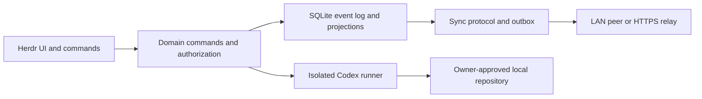

# Team coding assistant specification

This document is the source of truth for the product boundary and architecture. `idea.md` describes the product intent. `task.md` is the implementation checklist. `AGENTS.md` contains instructions that apply to every coding task.

## Product goal

Build a terminal-first application that lets a small team coordinate with each other's local coding agents and repositories. LAN peer connections remain supported. Internet mode uses an optional Cloudflare relay so devices behind separate home or office routers can exchange team records without exposing their laptops to inbound internet connections.

The application synchronizes team records only. Repository files remain on the repository owner's laptop.

## MVP boundary

The first usable version supports:

- One team.
- One device per teammate.
- Explicit team invitation and device pairing.
- A Herdr dashboard for local profile setup, team creation, six-digit invite codes, automatic signed join requests with dashboard approval/rejection, task assignment, broadcasts, local `/read`, and relay sync. Dashboard pairing uses clipboard codes and does not create JSON handoff files. The main workspace keeps Spaces and Agents visible beside the terminal and shows recent team tasks and broadcasts in a collapsible side panel.
- Local profiles with display name and role label.
- A linked local repository approved by its owner.
- Tasks, task status updates, follow-ups, broadcasts, and activity history.
- Offline records and queued requests that synchronize after reconnection.
- Direct peer-to-peer connections on the local network.
- Internet synchronization through a deployed Cloudflare Worker and per-team Durable Object relay.
- Permission-aware access to repository questions.

The relay stores only bounded, signed team events and delivery metadata. It never stores or synchronizes repository files, repository contents, private keys, or unbounded command output. The relay is a transport mailbox; each laptop keeps its own SQLite database and verifies event signatures, membership, permissions, revocation, and replay rules before applying events. HTTPS protects traffic to the relay. The relay operator can read team event payloads, so users must not put secrets or repository contents in tasks, broadcasts, or requests.

The first version does not include repository synchronization, automatic code changes, multi-device identity, or permission delegation unless a later decision explicitly adds them.

Approved prototype extension (2026-11-22): dashboard invitations use a six-digit relay lookup code, valid for ten minutes and one successful claim. The relay temporarily stores the signed invitation bundle, including its shared relay token; the relay operator can read this bundle. Clients still verify the original signature and require explicit manager approval. Legacy signed invite strings remain accepted. Expired codes are rejected and cleaned up by a Durable Object alarm. Short codes are shared privately and claim attempts are limited per IP.

## Commands

### `/task @person <description>`

Creates a task for a teammate. The current prototype CLI form is `herdr /task create` with explicit `--db`, `--team`, `--actor`, `--identity`, `--assignee`, and `--description` options. The task has a stable ID and a state machine:

`queued -> delivered -> in_progress -> done`

It may also enter `cancelled`, `failed`, or `needs_attention`. The recipient can send a follow-up. The sender and authorized leads can view task history; status changes must be recorded as events.

### `/broadcast <message>` (also accepts the legacy spelling `/brodcast`)

Creates a team or group message. The current prototype CLI form is `herdr /brodcast create` (also `herdr /broadcast create`) with explicit team and identity options. A broadcast is a signed event synchronized through LAN or the Internet relay; it is not a permission grant.

### `/check @person <question>`

Requests a repository question from a teammate's approved local repository. The request is authorized when it is created and re-authorized when it executes. The target laptop runs a separate agent process and returns a bounded result.

This command is only considered read-only if the execution boundary prevents writes. A prompt saying “do not edit files” is not sufficient enforcement.

### `/read <question>`

Starts a separate Codex session on the current terminal to answer a query about this device's approved local repository. It does not send repository content or the query through the team relay and does not attach to the user's active Codex session. The process must use Codex's read-only sandbox mode; if that boundary cannot start, the command must fail closed rather than launch an unrestricted process.

## Identity and trust

Every device creates a local public/private keypair. The private key never leaves the device. Display names and roles are labels and are not authentication credentials.

A team has a stable team ID and a team authority established by the creator. Joining requires an explicit invitation or pairing code. Membership, device additions, permission changes, and revocations are signed records.

The implementation must support:

- Rejecting a device that is not a member of the team.
- Device identity validation during connection setup.
- Revoking a device or membership.
- Preventing replay of old commands and events.
- Storing private keys using the operating system's protected storage when available.

mDNS is discovery only. Finding a device must never be treated as proof that it belongs to the team.

## Roles and permissions

Roles such as manager, group head, part head, and implementer are display and policy labels. Authorization is based on explicit grants.

Each grant identifies:

- Subject: member or device.
- Resource: team, group, member repository, task, or message scope.
- Action: for example `read_repo`, `create_task`, `update_task`, `broadcast`, or `manage_members`.
- Grantor.
- Whether delegation is allowed.
- Creation, expiry, and revocation information.

Permission inheritance is a graph traversal over valid grants. The graph must reject cycles. A member does not automatically inherit every permission held by a manager. A grant is delegable only when the grant explicitly permits delegation, and a delegate cannot grant more authority than they possess.

Permission checks occur both when a request is created and when it is executed. Revocation wins over inherited access. The UI must show the grant chain used to approve or deny an action.

## Local data and event model

Each device has its own SQLite database. Repository contents are never copied into the team database.

The database contains:

- Local profile and device identity metadata.
- Team membership and signed grants.
- An append-only event log.
- Derived task, message, request, and activity projections.
- Outbox and inbox delivery state.
- Schema and protocol versions.

Every event includes:

```text
event_id       globally unique event identifier
team_id        team scope
actor_id       member that authorized the action
device_id      device that produced the event
event_type     allow-listed event name
payload        validated event data
schema_version event schema version
logical_time   Lamport or hybrid logical clock value
signature      actor/device signature
```

Synchronization is idempotent: receiving an existing event is harmless. Events are validated before projection. The system must not silently delete conflicting history. Task status conflicts use deterministic causal ordering while retaining both events in the activity history.

The activity log is derived from accepted events; it is not a second source of truth.

## Peer connections and synchronization

The peer protocol must define:

- Connection authentication and team membership validation.
- Encrypted transport and application-level event signatures.
- Framing, protocol version negotiation, and maximum message size.
- Event exchange by missing event IDs or causal ranges.
- Acknowledgements, retries, backoff, and disconnect behavior.
- Replay protection and duplicate handling.
- Revocation propagation.

LAN mode may use authenticated TCP. Internet mode connects outbound over HTTPS to a Cloudflare Worker and routes bounded events through a Durable Object scoped to one team. The transport interface keeps LAN and relay transports replaceable. The relay validates protocol shape, size, team scope, event signatures, duplicate IDs, and conflicting IDs; clients still perform authoritative membership, revocation, permission, and projection checks before applying events. Relayed records are retained for offline teammates and bounded by per-team event count and bytes; the current prototype does not expire or compact mailbox history. Each client persists its own paging cursor after verified application and retains its authoritative local history.

The offline queue must expose these states:

`created -> queued -> delivered -> running -> completed`

with terminal or exceptional states `cancelled`, `expired`, `failed`, and `unauthorized`.

Queued requests must be rechecked against current permissions when they run. Requests need stable IDs, retry limits, cancellation behavior, and bounded payloads.

## Codex execution boundary

Agent execution is a separate subsystem from synchronization and the interactive Herdr session. It must not attach to or interrupt the user's active session.

For `/check`, the runner should:

- Launch a separate process with a bounded timeout.
- Expose the approved repository using a read-only filesystem boundary where supported.
- Restrict or explicitly document network access.
- Limit output size and preserve exit status.
- Record request ID, repository identifier, execution time, and result metadata.
- Return an explicit security status: enforced read-only, best-effort read-only, or failed to establish isolation.

If enforced read-only execution cannot be demonstrated on the target operating system, the feature must not be presented as safely read-only. The implementation should either require confirmation for best-effort execution or leave `/check` disabled.

## Privacy and failure behavior

- The application must not send repository files during normal synchronization.
- Logs must avoid secrets, private keys, and full repository contents.
- Local database and key storage locations must be documented.
- Malformed, oversized, unsigned, unauthorized, or unknown-version events must be rejected without crashing the app.
- Network loss must not lose locally accepted events.
- A failed request must remain inspectable and retryable or cancellable.
- A revoked member must not regain access by reconnecting with stale data.

## Architecture shape

Keep these boundaries separate:

1. UI and command parsing.
2. Domain commands and permission evaluation.
3. SQLite repositories and event projections.
4. Event synchronization and peer transport.
5. Agent execution and process isolation.

The Herdr UI should call the domain layer rather than directly mutating SQLite or network state. This allows the domain, sync, and execution layers to be tested without the terminal UI.



## Verification standards

Every implementation task must include evidence appropriate to its scope:

- Unit tests for permission evaluation, event validation, state transitions, and deduplication.
- Integration tests for two local profiles and reconnect synchronization.
- Negative tests for unknown peers, invalid signatures, revoked grants, malformed events, and duplicate delivery.
- Manual verification for the terminal workflow and two-device LAN behavior when hardware is available.
- A documented limitation when a platform-specific security property cannot be verified.

## Automatic join inbox (2026-11-22)

Entering an invite in the dashboard sends the signed join request to a per-team relay inbox automatically. The manager dashboard polls for pending requests and provides approve/reject actions. Listing and decisions require an authority signature, requester status requires the requester signature, and decisions bind to the exact signed request to prevent replay against a later request. Approval continues through local invitation/signature checks and signed membership events. The relay inbox retains at most 100 device requests for up to seven days (expired rows are removed on access). This mailbox is bounded team pairing metadata; repository files and private keys are excluded. Legacy manual signed-request approval remains an optional compatibility path.

## Dashboard relay bootstrap (2026-11-22)

For a new team, the dashboard uses the project default HTTPS relay unless explicitly configured, generates a cryptographically random bearer token, passes it to the create-team child through the environment, and retains it in the process credential sink before launching the action. Invites use the same explicit in-memory credentials. Credentials survive closing/reopening the dashboard within the process, but are not persisted across full application restart. Fresh profile IDs are unique; existing profile IDs are preserved.

## Approved guided user journey (2026-11-22)

This implementation supersedes the memory-only connection policy above: the user approved remembered connections, safe team switching, guided Create/Join onboarding, optional project/assistant setup, contextual repository-owner consent, named actions, readable answers/messages, retained drafts and accurate queued/delivered feedback. Protect saved connection credentials using the existing local identity protection boundary and authenticated encryption; Linux's owner-only unencrypted identity-key limitation remains explicit. Do not delete or repurpose existing team databases when switching. IDs remain internal. Membership approval does not grant repository access. Pending/rejected devices must not access team event streams. Team authorization remains explicit and signed; display role labels are not credentials. The terminal, Spaces, and Agents remain available. Repository data is never synchronized. Requests with limited execution isolation require explicit owner confirmation and must be labelled accurately.
